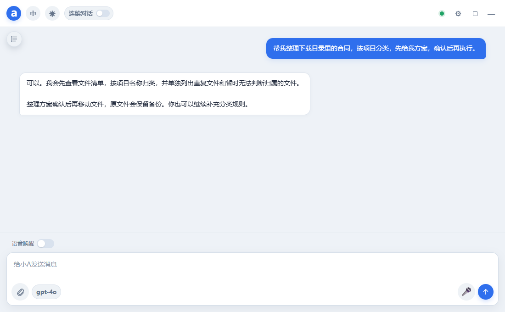
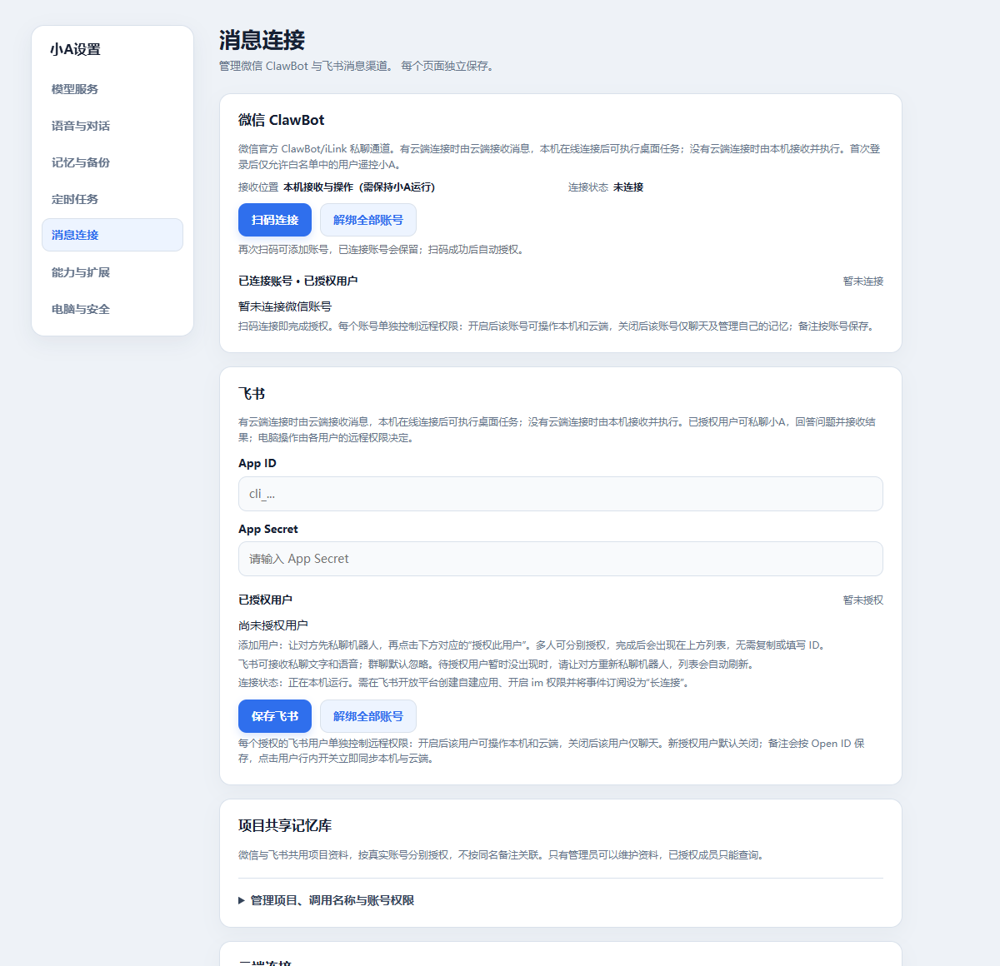
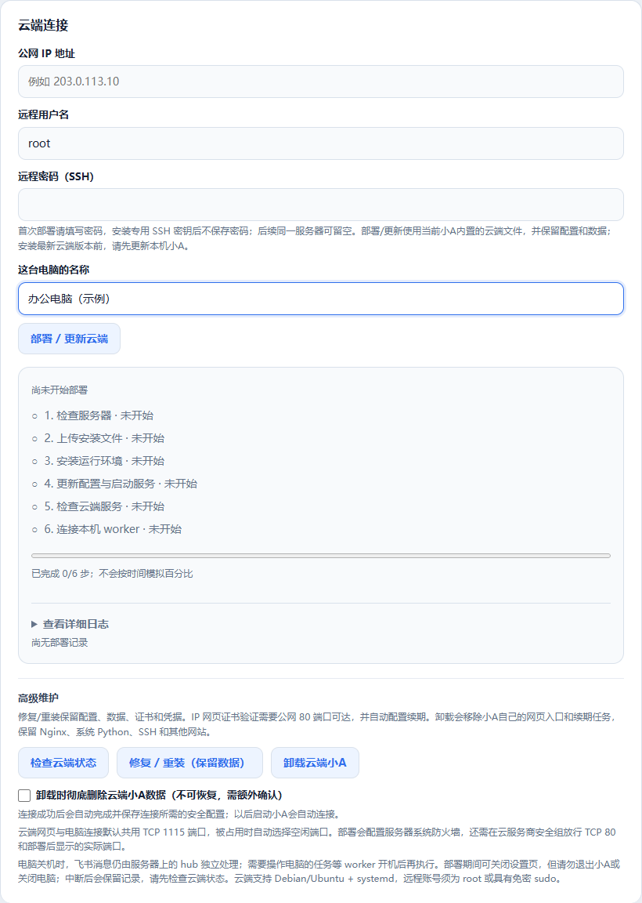

# 小A · Windows 桌面与云端协作助手

小A不只是聊天窗口，而是一个能通过自然语言处理文件、办公文档、网页和电脑操作的个人 AI 助手。它以 Windows 悬浮球和桌面对话窗口为入口，支持长期记忆、项目索引、自建工具、语音、微信与飞书接入；既可以在本机独立运行，也可以由云端保持在线、本地电脑执行桌面任务。

> **源码公开项目，禁止商用。** 本项目按 [PolyForm Noncommercial License 1.0.0](LICENSE) 发布，禁止商业使用；商业用途必须事先取得单独的书面授权，详见[商业授权说明](LICENSE-COMMERCIAL.md)。模型服务、消息渠道、语音和云服务器需按需配置，并非下载后即可免配置使用。

## 小A能帮你做什么

### 1. 便携版带着记忆换电脑

Windows x64 单文件 `XiaoA.exe`，内置运行环境，无需另装 Python、Node.js 或 Electron。退出小A后，把 **`XiaoA.exe` 和同目录的整个 `XiaoA-data` 文件夹一起复制**到另一台电脑，即可继续使用原有记忆、聊天记录、自建工具和项目资料，不必从零积累。仅复制 EXE 不会带走记忆；建议同时启用记忆备份。

模型密钥、消息渠道凭据等可能由当前 Windows 用户加密保护，换电脑后需重新填写或登录；已索引的原始项目文件也需迁移或重新指定路径。记忆可以延续，外部服务和本机软件仍需在新电脑准备好。

### 2. 维护云端服务器

通过 SSH 连接自有服务器，检查服务状态、查看日志、管理文件并执行维护命令；支持部署、更新、检查、修复和卸载小A云端服务。涉及修改的操作按权限与审批规则执行，云端服务升级保留已有配置和数据。

### 3. 多微信、多飞书连接与共享记忆

连接多个微信与飞书账号，按账号设置备注、授权用户及远程操作权限。各账号保留自己的私人记忆；明确授权后，可使用共享记忆与共享项目库协作，避免每个账号重新说明同一份资料。共享范围由权限决定。

### 4. 在云端持续办公

云端 hub 保持在线，可通过消息渠道或 HTTPS 网页处理对话、服务器文件、文档和定时任务；本地电脑在线时，再由 worker 执行 Windows、Office、CAD 与桌面操作。电脑关机后，云端仍能处理服务器侧任务；需要本机文件或桌面的工作等待本机重新上线。

### 5. 一句语音或一条消息，远程操控电脑

在微信或飞书给小A发一句语音或一条文字消息，就能让已授权的电脑执行任务：整理文件、处理 Word / Excel、操作网页，或调用电脑上已安装的软件；任务进度与结果通过消息渠道返回。例如：“把下载目录里的合同按项目整理，先给我方案。”

首次使用需连接消息渠道并开启对应账号的远程操作权限；语音功能需配置相应的识别服务或使用渠道提供的语音转文字。电脑需开机、联网并保持小A在线；采用云端协作时，本机 worker 也需保持连接。涉及敏感操作时仍按权限与审批规则执行。

[下载 Windows 便携版](https://github.com/QQ89937761/agent-a/releases/latest) · [查看更新记录](CHANGELOG.md) · [云端部署说明](deploy/部署说明.md)

## 应用界面

以下为小A实际界面的截图，使用独立的空白配置，不含个人账号、密钥或服务器资料；对话文字为演示内容。

### 对话与语音入口

用自然语言交代任务，支持语音输入、文件附件、多对话与任务进度。



### 微信、飞书与共享记忆

在同一设置页管理消息渠道、账号授权和项目共享资料。



### 云端部署与维护

填写自有服务器信息后部署云端服务，查看步骤进度，并按需检查、修复或卸载。



## 当前能力

| 能力 | 说明 |
| --- | --- |
| 桌面交互 | Windows 悬浮球、流式聊天、执行进度、停止任务、运行中补充或纠正要求，以及审批和完成提醒。 |
| 文件与办公 | 文件读写、搜索、下载和整理，Word / Excel 文档处理，以及已安装软件的电脑操作。 |
| 网页与电脑控制 | 浏览器操作、屏幕与区域截图、Windows UI Automation 和视觉定位；截图原图保留原始尺寸，模型观察图单独压缩。 |
| 模型与语音 | OpenAI 兼容模型网关和工具调用；可选腾讯云语音识别、语音合成与语音交互。 |
| 记忆与项目 | SQLite 长期记忆、对话记忆、固定与忘记、备份；常见代码/文本及 Word / Excel 的项目增量索引。 |
| 自建工具与扩展 | 小A可固化重复流程为 PowerShell 工具，经过语法检查和自测后启用，支持升级、回滚；可管理技能和独立运行环境的插件。 |
| 消息与定时任务 | 微信 ClawBot / iLink、飞书消息接入；支持一次性、每日、每周提醒或定时执行，区分本机与云端执行位置。 |
| 云端协作 | 云端 hub 负责对话、记忆和消息接入，本地 Windows worker 主动连接并执行电脑任务，支持身份校验、心跳和断线重连。 |
| 文件归档 | 未指定保存位置的任务成品、辅助脚本和过程文件统一进入隔离工作区，不默认散落到桌面或“文档”。 |
| 正式版运行 | Windows x64 单文件 EXE，内置后端及 Python / Node 插件运行环境，无需目标电脑另装 Python、Node.js 或 Electron。 |

### 聊天窗口背景

右键“小A”悬浮球 → **聊天窗口背景**，按以下顺序选择：

1. **标准背景**
2. **半透明背景**
3. **全透明背景**

全透明模式的窗口底层透明，内部控件背景采用 **30% 透明、70% 不透明**，文字和图标不整体降低透明度；三种模式都不显示工具执行标题的长条背景框。透明效果受系统透明效果设置及运行环境影响，不支持时会回退到标准背景。旧版保存的毛玻璃设置会自动转为半透明背景。

## 获取与运行

Windows x64 便携版由 GitHub Actions 构建，通过完整测试、文件校验和更新冒烟后，发布到 [GitHub Releases](https://github.com/QQ89937761/agent-a/releases)。下载 `XiaoA.exe` 即可运行；下载页同时提供构建校验清单。

从源码运行请按下方“从源码开发”安装 Python、Node.js 及项目依赖。便携版首次运行会在 EXE 同目录建立 `XiaoA-data`，存放本机配置、记忆、聊天记录、工具和其他运行数据。模型、语音、消息渠道和云端连接均需自行配置。

如需迁移电脑，先退出小A，再使用可信方式迁移程序目录与 `XiaoA-data`；不要把个人数据、配置或服务密钥上传到仓库或 Release。

## 本机独立运行与云端协作

| 模式 | 职责与边界 |
| --- | --- |
| `standalone` | 默认模式，本机负责对话、记忆和工具执行；本机退出或关机后不再处理任务。 |
| `hub` | 云端常驻，负责对话、记忆、消息渠道、云端任务和本机任务转发。 |
| `worker` | 本地 Windows 电脑主动通过 WSS 连接 hub，负责 Office、文件和桌面操作；断线自动重连。 |

```text
桌面聊天 / 微信 / 飞书 / HTTPS 网页
                  |
          云端 hub（保持在线）
          对话、记忆、消息、云端任务
                  |
          WSS，本地电脑主动连接
                  |
          Windows worker
          Office、文件、网页和电脑操作
```

- **电脑关机或 worker 离线时：** 云端仍可处理不依赖本机的对话和云端任务，但不能操作本机文件、Office 或桌面；本地定时任务也不会在关机状态运行。
- hub 的 `/health` 提供 worker 在线状态、电脑标识、最近心跳和待办数量。
- 本机自建工具的能力清单可同步到 hub；实际执行仍在对应 worker。
- 可按设置页中的间隔，将云端记忆快照和聊天历史备份到本地，保留独立版本。
- 支持免域名自签连接串或域名 + HTTPS/WSS；部署和重连步骤见 [云端部署说明](deploy/部署说明.md)。

## 文件与隔离工作区

**默认规则针对所有任务产物，不仅是 Word / Excel。**

- 用户没有明确指定保存位置时，文档、图片、下载内容、转换结果、辅助脚本及中间文件默认归入隔离工作区；命令工具默认也在这里执行。
- 用户指定了成品保存位置，或要求修改某个已有文件时，使用指定位置；辅助脚本和过程文件仍归入隔离工作区。
- 临时缓存和运行日志归入隔离区的独立目录。超过清理阈值时，只清理临时文件和日志，不自动删除工作区成品及安全备份。
- 配置、记忆、聊天记录、已安装工具和扩展有各自的数据目录，不属于可随意清理的任务缓存。

| 内容 | 源码运行默认位置 | 正式版运行默认位置（相对 EXE） |
| --- | --- | --- |
| 任务成品和过程文件 | `data\isolation\workspace` | `XiaoA-data\data\isolation\workspace` |
| 临时文件 | `data\isolation\tmp` | `XiaoA-data\data\isolation\tmp` |
| 运行日志 | `data\isolation\logs` | `XiaoA-data\data\isolation\logs` |
| 记忆数据库 | `data\memory\memory.sqlite3` | `XiaoA-data\data\memory\memory.sqlite3` |
| 默认备份 | `data\backup` | `XiaoA-data\data\backup` |
| 自建工具及历史版本 | `tools`、`tools\_history` | `XiaoA-data\tools`、`XiaoA-data\tools\_history` |

设置页可查看隔离工作区位置、容量及清理阈值。**隔离工作区是文件集中归档机制，不是操作系统权限沙箱**：命令、脚本和第三方扩展仍可能访问当前用户有权限访问的资源。

## 记忆、项目与重复流程

日常直接用自然语言即可，例如：

```text
记住：这个项目发布前必须先跑回归测试。
列出你记住的长期规则，把第 12 条改成新规则并固定。
忘记第 8 条过期记忆。
把 D:\work\my-project 加入项目记忆，然后查登录流程在哪里实现。
移除这个项目索引，不要删除原文件。
为这个重复流程创建一个工具，先用测试参数自测成功再启用。
列出你自己创建的工具，或把 hello_user 回滚到上一版。
```

记忆支持中文关键词检索；本地向量模型在后台加载，首次使用可能需要下载，失败时可使用关键词检索。项目索引按文件哈希增量更新，结果包含原文件路径及代码/文本行号或 Excel 工作表位置。

设置页可指定记忆备份目录、间隔和保留数量，也可“立即备份”。自建工具使用 `tool.json` 和 `tool.ps1` 保存，历史版本保留在 `_history` 中；应将经过验证的稳定流程固化为工具，而不是直接信任任意生成的脚本。

## 隐私与安全边界

- 本机服务默认仅监听 `127.0.0.1:1985`；云端连接需配置身份验证和 TLS。
- 敏感操作受风险识别、审批和隐私确认保护；远程消息渠道应配置允许用户白名单，不向陌生人开放电脑控制。
- 第三方扩展先展示内容，再明确确认安装；独立依赖环境不等于没有本机权限。
- 不把真实密钥、服务器密码、连接令牌、个人配置或数据写入说明文档、提交记录及发布附件。示例配置使用 [config.example.toml](config.example.toml)。
- 对话和工具结果会按任务需要发送给所配置的模型服务；启用云端、微信、飞书或语音时也会使用相应服务。**本地运行不代表所有数据都只留在本机。**
- 模型调用及已启用的云端、微信、飞书和语音功能会使用对应服务；在启用前应确认服务方、数据范围及账号权限。

## 从源码开发

以下环境要求只针对开发和构建，**不针对正式版使用者**：Python 3.10+、Node.js，以及按依赖清单安装的组件。

在项目根目录双击 `start.bat`，或在 PowerShell 中运行：

```powershell
.\start.bat
```

启动器使用 `%USERPROFILE%\xiaoa-venv`，按清单哈希准备或更新 Python 和 Electron 依赖，再启动桌面界面；后端由 Electron 拉起，不需要另开服务窗口。手动安装前端依赖请用 `npm ci`，保持与 `package-lock.json` 一致。

单独调试后端：

```powershell
& "$env:USERPROFILE\xiaoa-venv\Scripts\python.exe" -m uvicorn backend.api.server:app --host 127.0.0.1 --port 1985 --reload --reload-dir backend
```

源码启动支持后端自动重载；正式版的代码变更需要重新构建。可通过本机浏览器访问 `http://127.0.0.1:1985/`。配置保存是否需要重新连接，按设置页提示操作。

### 检查与构建

从项目根目录运行：

```powershell
& "$env:USERPROFILE\xiaoa-venv\Scripts\python.exe" -m backend.run_tests --strict
Push-Location frontend
npm run check
Pop-Location
```

构建时先在 CMD 中激活开发环境，再运行：

```bat
call "%USERPROFILE%\xiaoa-venv\Scripts\activate.bat"
cd frontend
npm run dist
```

`npm run dist` 会执行前后端检查、构建冻结后端、准备插件运行环境，最后生成 Windows x64 便携版 EXE。产物位于 `frontend\dist`；构建产物不会提交到 Git。正式版内置同版本云端部署文件，安装、更新或修复云端时从本机打包并通过 SSH 上传。

推送形如 `v1.0.42` 的版本标签后，GitHub Actions 会在 Windows 环境完成检查、构建并创建 GitHub Release；发布前请确认已通过本地测试。便携版更新器只读取该仓库的公开 Releases，开发版不会替换源码目录。

GitHub Actions 会运行后端严格测试、工具静态检查及完整前端检查。自动测试不能代替另一台电脑的正式版启动、Windows 桌面交互及 Office / CAD 真机验收。

## 第三方许可与安装包

本项目的禁止商用条款适用于有权授权的小A原创代码，第三方依赖保留各自许可。现有 PDF 渲染依赖 PyMuPDF 使用 AGPL / 商业双授权；发布含该依赖的 EXE 前须先解决许可兼容要求，详见[第三方许可说明](THIRD-PARTY-NOTICES.md)。构建与发布不会改变第三方组件的许可；使用和再分发请遵循这些组件的要求。

## 相关文档

- [更新记录](CHANGELOG.md)
- [云端部署说明](deploy/部署说明.md)
- [密钥迁移说明](docs/密钥迁移.md)
